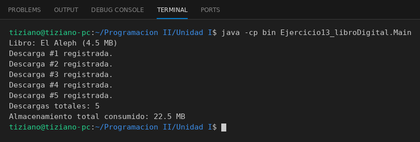

# LibroDigital

Programación II - Unidad 1 - Ejercicio 13

## Consigna
Modelar un libro digital que permita simular descargas y calcular el espacio total que ocupa en el servidor.

## Lógica
- **Atributos (privados):** `isbn`, `titulo` (String), `tamanioMB` (double) y `descargasTotales` (int).
- **Constructor, getters y setters:** `setTamanioMB` y `setDescargasTotales` validan que no sean negativos; el constructor los usa para que la validación valga también al crear el objeto.
- **`registrarDescarga()`:** incrementa en uno el contador de descargas.
- **`calcularEspacioConsumido()`:** retorna `tamanioMB * descargasTotales`.
- **`Main`:** libro de 4.5 MB, 5 descargas consecutivas y muestra el almacenamiento consumido (22.5 MB).

## Ejecución

